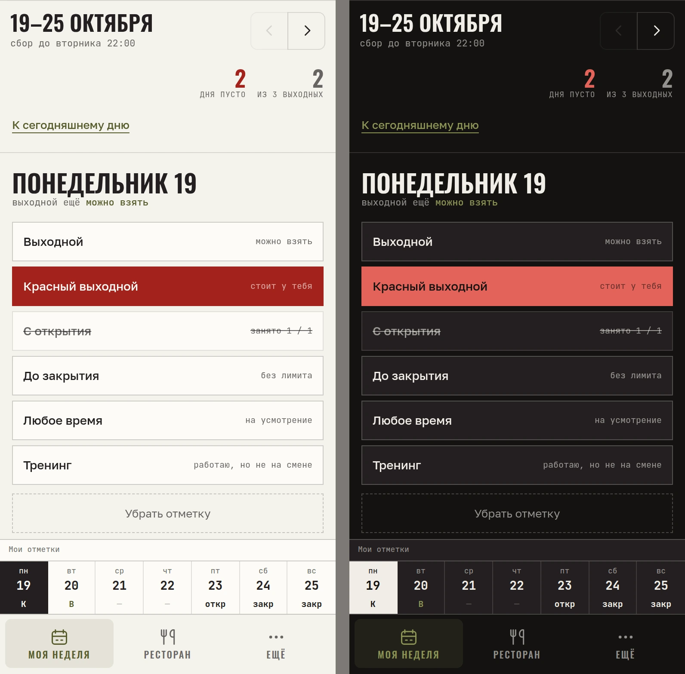
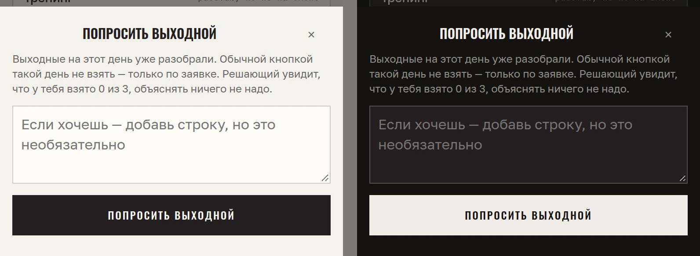
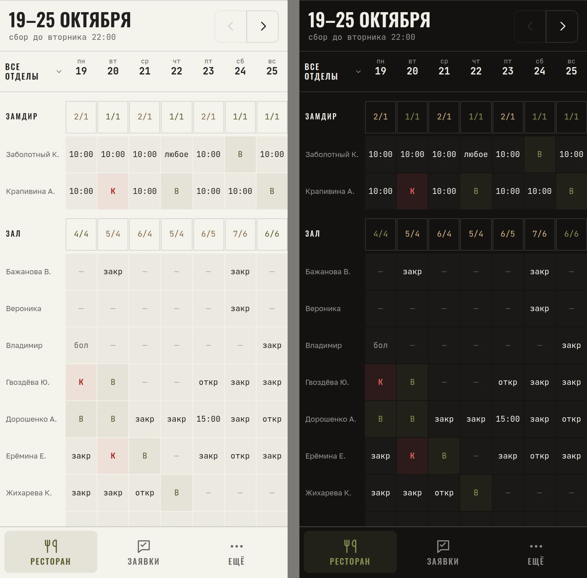
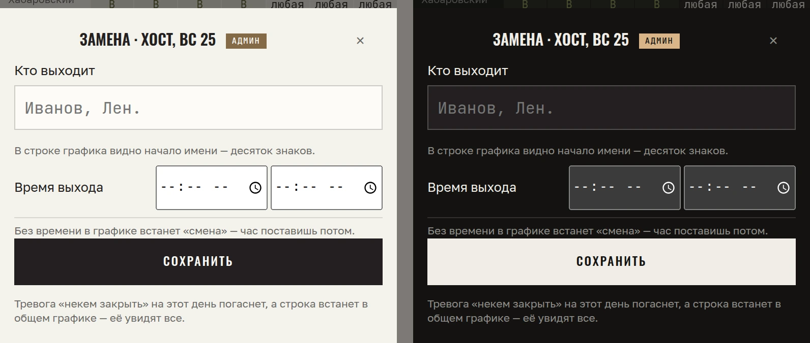
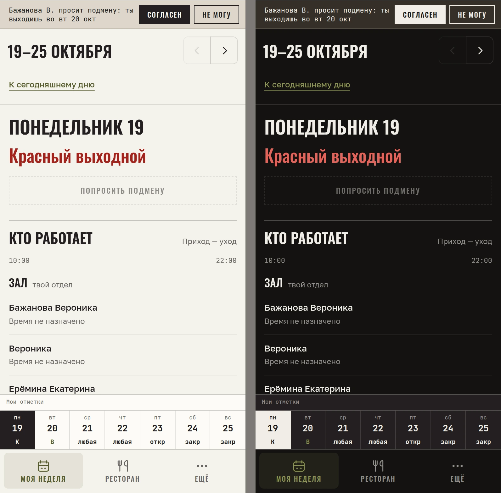
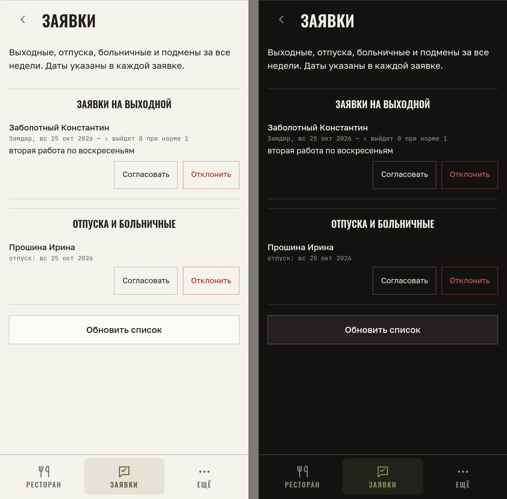

# График смен ресторана: Telegram Mini App и бот

**Сотрудники сами берут выходные и смены, старшие доводят неделю, директор публикует.**
В production с августа 2026 в ресторанной сети. Проект под NDA: без названий, имена на снимках вымышленные,
код закрыт. Здесь кейс, устройство и экраны.

*Сотрудник видит, сколько выходных ещё можно взять, какой слот уже занят («с открытия»: занято 1/1),
и ставит красный выходной, который нельзя снять без его ведома. Снимок со стенда на тестовом ростере, 390 px.*

## Задача

Знакомый директор ресторана составлял график вручную. Пожелания сотрудников приходили в рабочий чат вперемешку
и в любое время суток, руководитель ходил за людьми и выяснял, кто когда хочет выходной, смены назначали без
спроса, люди жаловались. Директор просил «таблицу в Google Диске», но нужная логика в таблицу не помещается:
лимит выходных на день по принципу «кто первый успел», пометка «выходной обязательно», сигнал «в этот день нужна
замена». Готовые сервисы и модуль персонала R-Keeper не дают сотрудникам самим выбирать смены, поэтому решил
делать своё.

## Как сделал

Рабочая переписка в компании идёт в Telegram, поэтому Telegram Mini App и бот: вход по Telegram ID, без
регистрации. Стек: Node.js 22, PostgreSQL, свой WebSocket для обновлений в реальном времени, сервер в РФ (152-ФЗ).
Если двое одновременно берут последний свободный выходной, его получает ровно один: это решает транзакция
в Postgres. Данные заведений изолированы на уровне базы (RLS).

Разработку вёл в VS Code с Claude Code и Codex. Код пишут агенты, я отвечаю за постановку и приёмку: интервью
с директором (опросник на 38 вопросов тоже собрал с AI), спецификация, архитектурные решения (ADR) и задачи
с заранее названным критерием готовности. Правила проекта и решения заказчика лежат в AGENTS.md, поэтому агент
не переспрашивает то, что уже решено. Результат проверяю на стенде и по данным production.

## Кто пользуется и что изменилось

**До.** Пожелания приходят в чат вперемешку, руководитель вручную сводит их к четвергу, смены назначают
без ведома сотрудника.

**После.** Десять недель графиков собраны в приложении (на 14.10.2026):

| Показатель | Значение |
|---|---|
| Сотрудников в графике | 22–26 в неделю |
| Из них сами ставят себе выходные и смены | 14–18 |
| Ячеек графика в неделю | 150–175, около половины заполняют сами сотрудники |
| Выходных, взятых самостоятельно | 35–54 % по неделям |

Цикл недели: окно сбора открывается в случайное время (воскресенье вечером или понедельник днём), дедлайн
во вторник 22:00, промолчавшие получают «любую смену», старшие отделов доводят неделю, директор публикует.
Руководитель видит собранную неделю и дни, где нужна замена, и доводит график в том же приложении,
без параллельной таблицы.

**Решения по данным.** Через месяц администраторы пожаловались на поток уведомлений. Посчитал по базе:
до 53 сообщений за две недели, 70–82 % из них — напоминания о заявках, которые уходили сразу четырём
администраторам трижды в сутки. Добавил кнопки «Согласовать» и «Отказать» прямо в сообщение бота:
заявку решают одним тапом, не открывая приложение.

## Экраны

Снимки со стенда на тестовом ростере, 390 px, слева светлая тема, справа тёмная. Шапка с логотипом заказчика обрезана.

**Выходной сверх потолка.** Когда выходные на день разобраны, обычной кнопкой его не взять: только заявкой,
решающий видит норму сотрудника.

**Ресторан глазами директора.** Сетка по отделам: сколько выбрали из нормы на каждый день, красные выходные,
больничные, «закр» и «откр» смены.

**Замена.** Там, где сработала тревога «некем закрыть», админ вписывает, кто выходит; строка встаёт в общий график.

**Опубликованная неделя и просьба о подмене.** Коллега просит подмену, ответ в одно нажатие прямо в полосе
над графиком.

**Заявки.** Выходные сверх нормы, отпуска, больничные и подмены в одном списке с кнопками «Согласовать»
и «Отклонить».

## Что внутри

- **Правила живут на сервере, вёрстка их повторяет.** Погашенная кнопка объясняет причину; тап по ней даёт
  тост, а не тихий отказ.
- **Одно правило — одна функция**, общая для сервера, клиента и стенда; паритет сторон проверяет контрактный
  тест. Нормы выходных, потолки и «нужна замена» считаются функциями в SQL, новый читатель зовёт функцию,
  а не пишет формулу заново.
- **Ячейку меняет одна функция** с фиксированным порядком замков; гонка за последний слот проверена
  сценарными наборами.
- **Сообщения идут через очередь (outbox):** доставка не теряется при перезапуске, напоминания не дублируются.
- **Realtime:** изменение расходится по WebSocket после коммита, у каждой точки своя комната.
- **Несколько заведений:** точки и отделы со своими настройками, изоляция данных через RLS.

## Как проверяю

Больше 2 100 автотестов без базы, сценарные проверки на одноразовой Postgres в Docker, проверки интерфейса
в браузере в обеих темах. Разрушающие проверки отказываются работать на базе с пометкой production.

Ночной автопрогон: агент берёт задачу из очереди, при зелёных тестах и разрешении релизного гарда выкатывает
код сам, при красном smoke-тесте откатывает; расходы ограничены потолком, отчёт приходит в Telegram.
Релизный гард не пускает выпуск в пик сбора пожеланий, миграции идут только вне открытого сбора, а схема
остаётся совместимой с прошлой версией кода, чтобы откат был возможен.

## Что не вошло

Исходный код, история и данные: проект под NDA, в базе персональные данные сотрудников. Код и архитектуру
подробнее показываю на интервью.
